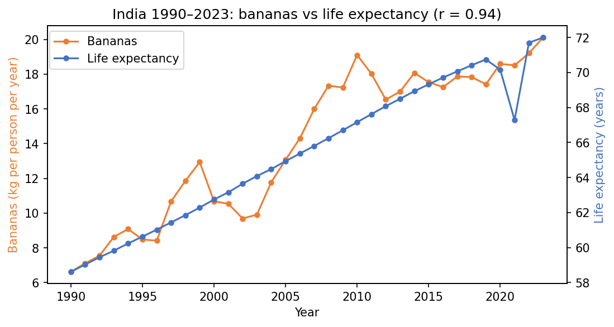
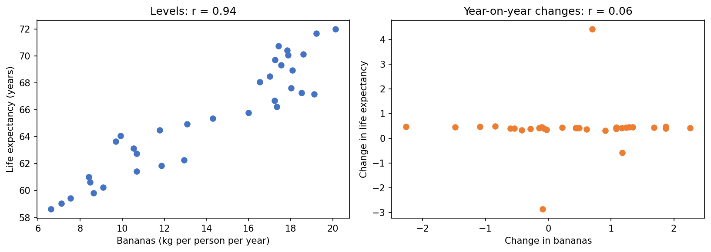
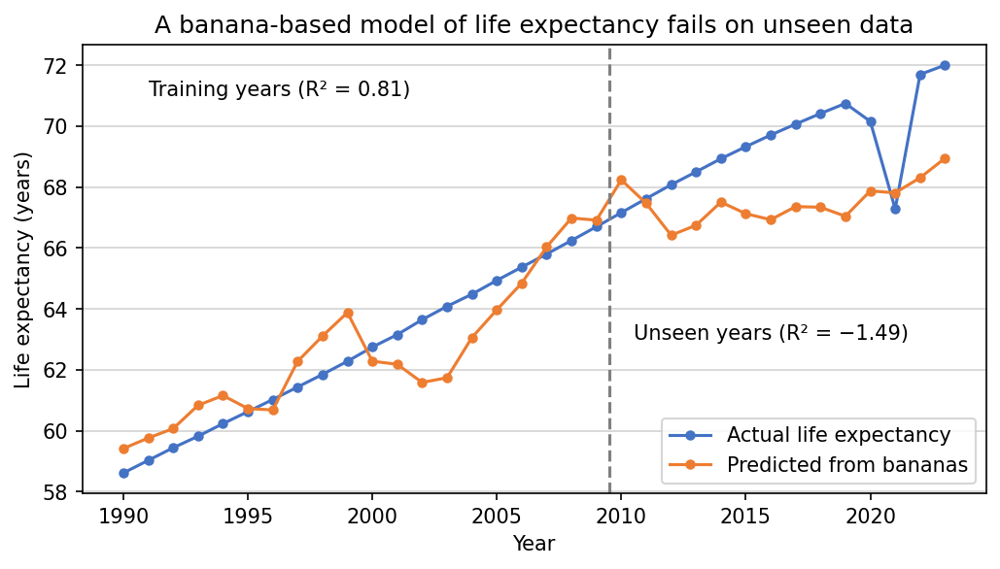

# Spurious Correlations Explorer

**Why bananas don't make you live longer.**

In India between 1990 and 2023, banana supply per person and life expectancy
have a correlation of **0.94**. This project shows why that number means
almost nothing, using 12 unrelated datasets from Our World in Data.

It began as an observation in my IB Theory of Knowledge essay. I turned it
into a data science project to test the claim properly.

## Key findings

| Test | Result |
|---|---|
| Correlation in levels | r = 0.94 (p ≈ 10⁻¹⁶) |
| Correlation in year-on-year changes | r = 0.06 (p = 0.73) |
| Partial correlation, controlling for GDP per capita | 0.66 |
| Partial correlation, controlling for log GDP per capita | 0.26 |
| Partial correlation, controlling for year | 0.25 |
| Pairs "significant" at p < 0.05 in levels | 53 of 66 (about 3 expected by chance) |
| Still significant after Bonferroni, in levels | 46 of 66 |
| Significant after detrending and Bonferroni | 4 of 66 |
| The same, excluding 2020–2023 | 1 of 66 |

## 1. The correlation

Both series rise over the period, which produces r = 0.94.

## 2. Detrending

Correlating year-on-year changes (first differences) removes the shared
trend. The correlation falls to 0.06. Life expectancy rose by about 0.4
years every year regardless of what banana supply did.

## 3. Controlling for a hidden driver

Controlling for GDP per capita only reduces the correlation to 0.66, because
GDP grows exponentially while the other two series grow roughly linearly.
Controlling for log GDP gives 0.26, almost identical to controlling for the
year itself (0.25). The data cannot separate "GDP drives both" from "both
simply rose over time".

## 4. Multiple comparisons

Testing all 66 pairs of the 12 datasets gives 53 "significant" correlations,
where chance alone predicts about 3. The Bonferroni correction barely helps
in levels (46 remain), because p-values assume independent observations and
trending yearly data is strongly autocorrelated. After detrending, 4 pairs
survive Bonferroni, and all have a plausible mechanism: internet share with
internet users, air passengers with tourist trips, and CO₂ with each of the
two travel measures. Excluding the pandemic years leaves only one: internet
share with internet users, which are nearly the same measurement.

## 5. A model that fails

A linear regression predicting life expectancy from bananas, trained on
1990–2009, scores R² = 0.81 on its training years and R² = −1.49 on
2010–2023. It performs worse than guessing the average.

## Limitations

- Only 34 annual observations per series.
- Internet share and number of internet users are not independent datasets.
- International tourist trips has 7 missing years; pairwise deletion was used.
- First differencing is one of several detrending methods.
- Pearson correlation measures linear association only and is sensitive to
  outliers such as the 2020–2021 pandemic shock.

## Files

- `spurious_correlations_explorer.ipynb`: the full analysis (opens in Google Colab)
- `india_13_datasets_1990_2023.csv`: snapshot of the data used
- `*.png`: figures

## Data

All data is from [Our World in Data](https://ourworldindata.org), downloaded
in November 2026. The notebook contains the exact source link for each dataset.

## Tools

Python, pandas, NumPy, SciPy, scikit-learn, matplotlib.
